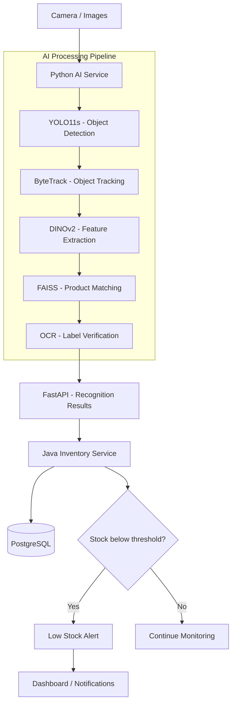
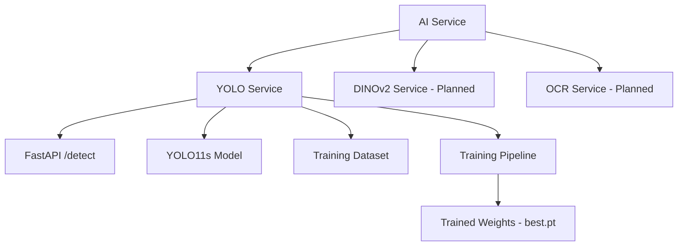

# AI Product Recognition

A Python-based AI system for detecting, recognizing, and tracking products in warehouse environments.

The system uses computer vision to identify products from images and video streams. Recognition results will be sent to a Java Inventory Service to monitor stock levels and generate low-stock alerts.

## System Architecture


## Tech Stack

### Current Technologies

- **Python 3.10** — Main programming language
- **FastAPI** — REST API framework
- **Ultralytics YOLO11s** — Object detection and model fine-tuning
- **PyTorch** — Deep learning framework
- **DINOv2** — Visual feature extraction and product representation
- **FAISS** — Similarity search for product identification
- **OCR** — Product label and text recognition
- **ByteTrack** — Multi-object tracking
- **Docker** — Containerization and deployment
- **Java Inventory Service** — Inventory management and stock monitoring
- **PostgreSQL** — Product and inventory data storage

## Project Structure



### Directory Structure

```text
ai-service/
├── README.md
├── .gitignore
└── yolo-service/
    ├── main.py
    ├── train.py
    ├── yolo11s.pt
    ├── dataset/
    │   └── merilka-50ml/
    │       ├── data.yaml
    │       ├── images/
    │       │   ├── train/
    │       │   └── val/
    │       └── labels/
    │           ├── train/
    │           └── val/
    └── runs/
```

> Model weights, datasets, and training outputs are stored locally and excluded from Git.

## YOLO Service

The YOLO service detects and localizes products in images using the YOLO11s object detection model.

The pretrained model can be fine-tuned on custom product datasets to recognize warehouse-specific products.

### Run the API

Navigate to the `yolo-service` directory:

```bash
cd yolo-service
uvicorn main:app --host 127.0.0.1 --port 18101 --reload
```

Swagger UI:

http://127.0.0.1:18101/docs

### API Endpoints

The YOLO service exposes the following REST API endpoints:

| Method | Endpoint | Description |
|---|---|---|
| POST | `/detect` | Detects objects in an uploaded image. |
| POST | `/track` | Tracks objects across sequential frames using ByteTrack. |
| GET | `/health` | Returns the service health status. |
| GET | `/yolo-names` | Returns the available YOLO model classes. |

Full interactive API documentation is available through Swagger UI:

**http://127.0.0.1:18101/docs**

> **Note:** The `/track` endpoint currently accepts individual images. Tracking across frames requires sequential requests, and multi-camera session management is not yet implemented.

### Model Training

The YOLO11s model can be fine-tuned using a custom annotated dataset.

Start training:

```bash
python train.py
```

Current training dataset configuration:

```text
dataset/merilka-50ml/data.yaml
```

Training generates model weights:

- `best.pt` — Best model checkpoint based on validation performance
- `last.pt` — Model checkpoint from the final training epoch

### Run Inference

Test the fine-tuned model using the YOLO command-line interface:

```bash
yolo predict \
  model=runs/detect/runs/products_v1-5/weights/best.pt \
  source=dataset/merilka-50ml/images/val/5.jpg \
  conf=0.25 \
  save=True
```

The prediction output includes detected product classes, bounding boxes, and confidence scores.

### Model Limitations

The initial model was trained using a very small dataset and is intended for technical validation.

Additional annotated images and testing on unseen products are required before using the model in a production warehouse environment.

## Java Inventory Service Integration

The Python AI Service will provide product recognition results to a separate Java Inventory Service.

The Java service will be responsible for:

- Maintaining product and inventory records
- Processing product detection and counting results
- Monitoring stock levels
- Comparing quantities against minimum stock thresholds
- Generating low-stock alerts
- Providing inventory information to a dashboard or other applications

> This is a proposed integration format, not an implemented API contract.

Visible product counts do not necessarily represent total warehouse inventory. The Java service will need to distinguish observed shelf quantities from actual inventory records.


## Development Status

### Completed

- [x] YOLO11s object detection
- [x] FastAPI REST API
- [x] Initial custom model training
- [x] Basic ByteTrack integration

### Planned

- [ ] Evaluation using unseen product images
- [ ] Automated import of multiple product datasets
- [ ] Product recognition with DINOv2 and FAISS
- [ ] OCR integration
- [ ] ByteTrack object tracking
- [ ] Integration with Java Inventory Service
- [ ] Low-stock monitoring and alerts
- [ ] Docker containerization and deployment

## Project Goal

Build a modular, scalable AI-powered product recognition system that supports warehouse inventory monitoring.

The long-term goal is to combine computer vision with inventory management to improve product visibility, detect low-stock situations, and support timely replenishment decisions.
