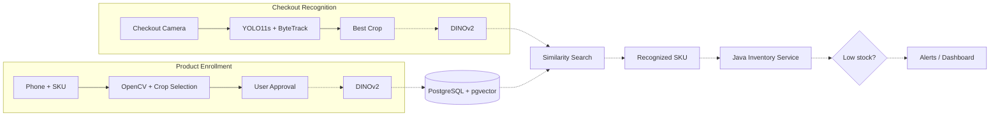

# AI Product Recognition

A Python-based AI system for detecting, recognizing, and tracking products in warehouse environments.

The system uses computer vision to identify products from images and video streams. Recognition results will be sent to
a Java Inventory Service to monitor stock levels and generate low-stock alerts.

## System Architecture



## Tech Stack

### Current Technologies

- **Python 3.10** — Main programming language
- **FastAPI** — REST API framework
- **Ultralytics YOLO11s** — Object detection and model fine-tuning
- **PyTorch** — Deep learning framework
- **DINOv2** — Visual feature extraction and embedding generation
- **ByteTrack** — Multi-object tracking
- **OpenCV** — Video processing, product localization, and image cropping

### Planned Technologies

- **Vector Similarity Search** — Product identification using embeddings (FAISS or PostgreSQL + pgvector)
- **OCR** — Product label and text recognition
- **PostgreSQL** — Persistent product and embedding storage (if pgvector is selected)
- **Java Inventory Service** — Inventory management and stock monitoring
- **Docker** — Containerization and deployment

## Project Structure

```mermaid

%%{init: {"flowchart": {"nodeSpacing": 12, "rankSpacing": 25}}}%%
flowchart LR
    A["AI Product Recognition"] -----> B["YOLO Service"]
    A -----> C["DINOv2 Service"]
    B -----> D["Detection & Tracking"]
    D ------ E["Product Enrollment"]
    E ------ F["Model Training"]
    C -----> G["Image Encoder"]
    G ------ H["Embedding API"]
    classDef compact font-size: 11px, padding: 3px;
class A, B, C, D, E, F, G, H compact;

```

### Directory Structure

```text
ai-service/
├── README.md
├── yolo-service/
│   ├── api.py
│   ├── detection/
│   ├── enrollment/
│   ├── models/
│   ├── dataset/
│   └── train.py
└── dinov2-service/
    ├── api.py
    ├── dinov2_encoder.py
    └── tests/
```

> Model weights, datasets, and training outputs are stored locally and excluded from Git.

## YOLO Service

The YOLO service detects and localizes products in images using the YOLO11s object detection model.

The pretrained model can be fine-tuned on custom product datasets to recognize warehouse-specific products.

For API endpoints, implementation details, and setup instructions, see
the [YOLO Service README](yolo-service/README.md).

## DINOv2 Service

The DINOv2 service generates 384-dimensional visual embeddings from product images using the pretrained
`facebook/dinov2-small` model.

The image encoder and `/encode` API are implemented and tested. These embeddings will be used for product similarity
search and SKU recognition.

For implementation details and API documentation, see the [DINOv2 Service README](dinov2-service/README.md).

## Java Inventory Service Integration

The Python AI Service will provide product recognition results to a separate Java Inventory Service.

The Java service will be responsible for:

- Maintaining product and inventory records
- Processing product detection and counting results
- Monitoring stock levels
- Comparing quantities against minimum stock thresholds
- Generating low-stock alerts
- Providing inventory information to a dashboard or other applications

> This is a proposed integration format, not an implemented API contract.

Visible product counts do not necessarily represent total warehouse inventory. The Java service will need to distinguish
observed shelf quantities from actual inventory records.

## Running the Project

### Start Docker Services

```bash
docker compose up -d
```

The YOLO and DINOv2 services run independently and require separate terminals.

Run the following commands from the `ai-service/` directory.

### YOLO Service — Port 18101

```bash
cd yolo-service
../.venv/bin/uvicorn api:app --host 0.0.0.0 --port 18101 --reload
```

Swagger UI: http://127.0.0.1:18101/docs

### DINOv2 Service — Port 18102

Open a second terminal:

```bash
cd dinov2-service
../.venv/bin/uvicorn api:app --host 0.0.0.0 --port 18102 --reload
```

Swagger UI: http://127.0.0.1:18102/docs

### Stop the Services

Press `Ctrl+C` in each terminal.

### Running Integration Tests

Make sure the YOLO and DINOv2 services are running and PostgreSQL is available.

From the `ai-service/` directory, run:

```bash
make test
```

This runs the Enrollment and Recognition integration tests.

The tests can also be executed individually:

```bash
.venv/bin/python -m unittest discover -s yolo-service/tests -p "test_approval_integration.py" -v
.venv/bin/python -m unittest discover -s dinov2-service/tests -p "test_recognition_integration.py" -v
```

## Cloudflare Tunnel (Remote Access)

The application can be accessed remotely through Cloudflare Tunnel without exposing local service ports directly to the
internet.

**Public URL:**

https://ai-product-recognition.my-expenses.xyz

### Service Routing

The tunnel routes requests to the locally running services:

| Endpoint                | Local Service              |
|-------------------------|----------------------------|
| `/enroll`               | YOLO — `127.0.0.1:18101`   |
| `/api/products/preview` | YOLO — `127.0.0.1:18101`   |
| `/api/products/approve` | YOLO — `127.0.0.1:18101`   |
| `/recognize`            | DINOv2 — `127.0.0.1:18102` |

## Development Status

### Completed

- [x] YOLO11s object detection
- [x] FastAPI REST API
- [x] Initial custom model training
- [x] ByteTrack object tracking
- [x] Product cropping and best-crop selection
- [x] Product Enrollment — video processing, crop selection, and user approval
- [x] DINOv2 image encoder and `/encode` API

### In Progress

- [ ] Integration between Product Enrollment and DINOv2

### Planned

- [ ] Persistent storage of product embeddings and SKU mappings
- [ ] Vector similarity search for product recognition
- [ ] Checkout product recognition and SKU identification
- [ ] Evaluation using unseen product images
- [ ] Automated import of multiple product datasets
- [ ] OCR integration
- [ ] Integration with Java Inventory Service
- [ ] Low-stock monitoring and alerts
- [ ] Docker containerization and deployment
- [ ] Set up GitHub Actions CI to run Enrollment and Recognition integration tests automatically.
    - `yolo-service/tests/test_approval_integration.py`
    - `dinov2-service/tests/test_recognition_integration.py`
- [ ] Add scheduled cleanup of temporary crop images (yolo-service/crops/).

Така не се обвързваш предварително нито с FAISS

## Project Goal

Build a modular, scalable AI-powered product recognition system that supports warehouse inventory monitoring.

The long-term goal is to combine computer vision with inventory management to improve product visibility, detect
low-stock situations, and support timely replenishment decisions.
