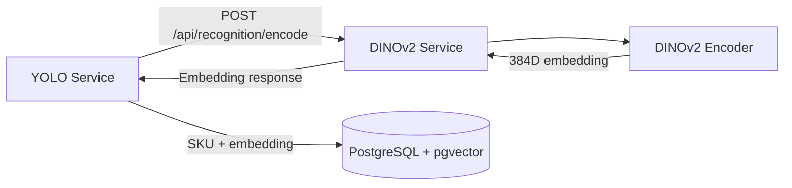
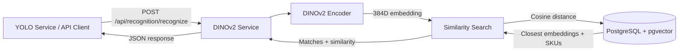

# DINOv2 Product Recognition Service

DINOv2 Service generates 384-dimensional image embeddings and recognizes previously enrolled products using PostgreSQL
with pgvector.

The service uses the pretrained `facebook/dinov2-small` model. Embeddings are L2-normalized and compared using cosine
similarity.

## Product Enrollment — Image Encoding

During enrollment, YOLO Service sends each approved product image to DINOv2 `/api/recognition/encode`.

DINOv2 generates an embedding and returns it to YOLO Service, which persists the SKU and embedding in PostgreSQL.



## Product Recognition

When a new product image is received, DINOv2 generates an embedding and searches for similar embeddings in PostgreSQL
using pgvector cosine distance.



The recognition endpoint currently returns the five closest stored embeddings. Multiple results may belong to the same
SKU.

A similarity threshold for unknown products is not yet implemented.

> **Note:** When a product is recognized, a `StockAdjustmentRequested` Kafka event (operation: DECREASE) is published
> (see `ai-pr-event-contracts`).

The service requires PostgreSQL with pgvector and a configured `DATABASE_URL` environment variable.

## API Examples

### Generate Image Embedding

`POST /api/recognition/encode` generates a 384-dimensional embedding from an uploaded image.

```bash
curl -X POST http://127.0.0.1:18102/api/recognition/encode \
  -F "file=@/path/to/product.jpg"
```

Example response (embedding shortened for readability):

```json
{
  "embedding_dimension": 384,
  "embedding": [
    0.012,
    -0.034,
    0.056
  ]
}
```

### Recognize a Product - example

POST /api/recognition/recognize generates an embedding from an uploaded image and searches PostgreSQL using pgvector to find the most
similar enrolled products.

```bash
curl -X POST http://127.0.0.1:18102/api/recognition/recognize \
  -F "file=@/path/to/product.jpg"
```

Example response (embedding shortened for readability):

```json
{
  "status": "matched",
  "matches": [
    {
      "sku": "123456789",
      "similarity": 0.95
    },
    {
      "sku": "987654321",
      "similarity": 0.82
    }
  ]
}
```

Seed the example product into PostgreSQL (only required once):

```bash
python dinov2-service/seed_test_product.py
```

Recognize the example product:

```bash
curl -X POST http://127.0.0.1:18102/api/recognition/recognize \
  -F "file=@dinov2-service/resources/test-product.png"
```

Example response:

```json
{
  "status": "matched",
  "matches": [
    {
      "sku": "123456789",
      "similarity": 1.0
    }
  ]
}
```

These are illustrative values. Currently, `matched` indicates that the database returned candidates, not that a
similarity threshold was passed.

If the database contains no embeddings, the endpoint returns:

```json
{
  "status": "unknown",
  "matches": []
}
```

## Image Encoder

The encoder accepts JPEG and PNG images, handles EXIF orientation, and converts images to RGB.

The pretrained `facebook/dinov2-small` model runs in evaluation and inference mode. The CLS token produces a
384-dimensional, L2-normalized `float32` embedding.

The model is loaded through `get_encoder()` and reused within the process.

On first use, pretrained weights may be downloaded from Hugging Face. Subsequent runs use the local model cache.

## Tests

Run the existing encoder tests from `ai-service/`:

```bash
.venv/bin/python -m unittest discover -s dinov2-service/tests
```

## API Documentation

FastAPI provides interactive API documentation at:

- Swagger UI: http://127.0.0.1:18102/recognize/docs
- OpenAPI schema: http://127.0.0.1:18102/recognize/openapi.json
- [Route compatibility and deprecated file catalog](../ROUTES.md)

## TODO — Product Recognition

- [x] Integrate DINOv2 image encoder.
- [x] Generate 384-dimensional image embeddings.
- [x] Implement POST /api/recognition/encode.
- [x] Integrate PostgreSQL with pgvector.
- [x] Implement cosine similarity search.
- [x] Implement POST /api/recognition/recognize.
- [x] Verify recognition with an enrolled product image.
- [ ] Return unique product SKUs with their best similarity scores.
- [ ] Implement similarity threshold for unknown products.
- [ ] Add automated recognition integration tests.
- [ ] Test recognition with new camera images.
- [ ] Integrate recognition results with the Java Inventory Service.
