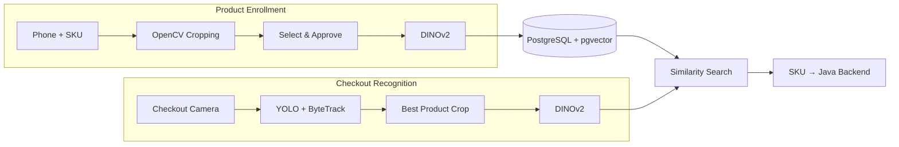

## Product Enrollment

The YOLO service includes a product enrollment workflow that allows users to register new products using a mobile phone
camera.

### Architecture



## Object Detection and Tracking

The YOLO service detects and tracks objects in images and videos using YOLO11s and ByteTrack.

Its primary purpose is to locate products at the checkout, extract product crops, and eventually send them to DINOv2 for
recognition.

### Detection and Tracking Pipeline


### Implementation

The enrollment functionality is implemented in the `enrollment/` package:

| File                     | Responsibility                                           |
|--------------------------|----------------------------------------------------------|
| `api.py`                 | FastAPI endpoints for detection and tracking             |
| `detection/crop.py`      | Extract object crops from bounding boxes                 |
| `detection/best_crop.py` | Save the best-quality crop for each tracked object       |
| `routes.py`              | FastAPI endpoints for preview and approval               |
| `video.py`               | Extract frames from uploaded videos                      |
| `localization.py`        | Locate and crop products using OpenCV                    |
| `selection.py`           | Score crops and select diverse images                    |
| `sessions.py`            | Manage temporary enrollment sessions                     |
| `encoding.py`            | Convert selected images into DINOv2 embeddings, if added |
| `static/enroll.html`     | Mobile-friendly enrollment interface                     |
| `static/enroll.js`       | Camera recording, preview, selection and approval        |

### API Endpoints

| Method | Endpoint                | Description                                             |
|--------|-------------------------|---------------------------------------------------------|
| GET    | `/enroll`               | Open the enrollment interface                           |
| POST   | `/api/yolo/products/preview` | Process video and return selected product crops         |
| POST   | `/api/yolo/products/approve` | Validate selected images against the enrollment session |
| POST   | `/api/yolo/detect`           | Detect objects in a single image                        |
| POST   | `/api/yolo/track`            | Track objects and extract crops from an image           |
| POST   | `/api/yolo/track-video`      | Track objects in video and save the best crop per track |
| GET    | `/api/yolo/health`           | Check service health                                    |
| GET    | `/api/yolo/names`            | Return YOLO model class names                           |

Swagger: `/yolo/docs`. See [full route map and compatibility](../ROUTES.md),
including camera HTTP/WebSocket routes and unchanged HTML pages.

### Current Status

**Implemented:**

- YOLO11s object detection
- ByteTrack object tracking
- Bounding box extraction
- Object cropping
- Best-crop selection per tracked object in uploaded videos

**Planned:**

- Send selected product crops to DINOv2
- Search stored embeddings using pgvector
- Resolve recognized products to SKU
- Integrate recognition results with the Java backend

Temporary enrollment sessions expire after 30 minutes. Session metadata is currently stored in process memory, so
sessions do not survive an application restart.

## Product Enrollment

The YOLO service includes a product enrollment workflow that allows users to register new products using a mobile phone
camera.

### Enrollment Pipeline


### Implementation

The enrollment functionality is implemented in the `enrollment/` package:

| File                 | Responsibility                                                       |
|----------------------|----------------------------------------------------------------------|
| `routes.py`          | FastAPI endpoints for preview and approval                           |
| `video.py`           | Extract frames from uploaded videos                                  |
| `localization.py`    | Locate and crop products using OpenCV                                |
| `selection.py`       | Score crops and select diverse images                                |
| `sessions.py`        | Manage temporary enrollment sessions                                 |
| `encoding.py`        | Convert selected images into DINOv2 embeddings (planned integration) |
| `static/enroll.html` | Mobile-friendly enrollment interface                                 |
| `static/enroll.js`   | Camera recording, preview, selection and approval                    |

### API Endpoints

| Method | Endpoint                | Description                                             |
|--------|-------------------------|---------------------------------------------------------|
| GET    | `/enroll`               | Open the enrollment interface                           |
| POST   | `/api/yolo/products/preview` | Process video and return selected product crops         |
| POST   | `/api/yolo/products/approve` | Validate selected images against the enrollment session |

> **Note:** After successful approval, a `ProductCreationRequested` Kafka event is published
> (see `ai-pr-event-contracts`).

## Live Camera — YOLO + ByteTrack

Run real-time object detection and tracking using a connected webcam.

From the `yolo-service` directory:

```bash
../.venv/bin/yolo track model=models/yolo11s.pt source=0 tracker=bytetrack.yaml show=True
```

**Note:** Close browser tabs or applications using the webcam before starting YOLO. If the camera is busy, OpenCV may
fail to open `/dev/video0`.

This command runs YOLO tracking directly from the terminal. Product SKU recognition through DINOv2 is not yet integrated
into this live camera workflow.

### Model Training

The YOLO11s model can be fine-tuned using a custom annotated dataset.

Start training:

```bash
python train.py
```

Current training dataset configuration:

```text
dataset/merilka-50ml/data.yaml
```

Training generates model weights:

- `best.pt` — Best model checkpoint based on validation performance
- `last.pt` — Model checkpoint from the final training epoch

### Run Inference

Test the fine-tuned model using the YOLO command-line interface:

```bash
yolo predict \
  model=runs/detect/runs/products_v1-5/weights/best.pt \
  source=dataset/merilka-50ml/images/val/5.jpg \
  conf=0.25 \
  save=True
```

The prediction output includes detected product classes, bounding boxes, and confidence scores.

### Model Limitations

The initial model was trained using a very small dataset and is intended for technical validation.

Additional annotated images and testing on unseen products are required before using the model in a production warehouse
environment.

### Current Status

**Implemented and tested:**

- Mobile camera recording
- 12-second video capture
- Video frame extraction using OpenCV
- OpenCV-based product localization
- Crop quality scoring and diverse image selection
- Temporary enrollment session storage
- User preview and manual image selection
- Approval validation API
- DINOv2 encoding tested independently with a real product crop (384-dimensional embedding)

**In progress:**

- Integration of DINOv2 encoding into the enrollment approval API
- Product and embedding persistence in PostgreSQL using pgvector

**Planned:**

- Improvements to product localization and crop selection
- Product similarity search using stored embeddings

### Temporary Sessions

Enrollment previews are stored in temporary sessions.

- Each session contains selected product images and their identifiers.
- Users can review and approve images before enrollment.
- Sessions expire after 30 minutes.
- Session metadata is currently stored in process memory.
- Sessions do not survive an application restart.

Currently, the approval endpoint validates the selected images but does not yet save products or embeddings to the
database.
