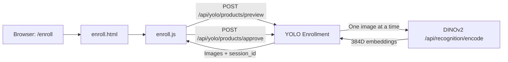
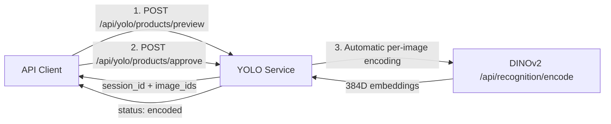

# Enrollment via Web UI

# Enrollment via API Client

The process consists of three steps:

1. POST /api/yolo/products/preview — Upload a video and SKU. Returns a session_id and a list of candidate images (image_id).
2. POST /api/yolo/products/approve — Submit the session_id and selected image_ids.
3. POST /api/recognition/encode — Automatically called by YOLO Service once per approved image. No manual API call is required.

TODO — Product Enrollment

- [x] Extract frames from uploaded video.
- [x] Detect and crop products using YOLO.
- [x] Select up to 10 high-quality, diverse images.
- [x] Implement Enrollment Preview UI (enroll.html).
- [x] Implement POST /api/yolo/products/preview.
- [x] Implement POST /api/yolo/products/approve.
- [x] Integrate YOLO Service with DINOv2 /api/recognition/encode.
- [x] Generate 384-dimensional embeddings for approved images.
- [x] Set up PostgreSQL with pgvector.
- [x] Create products and product_embeddings tables.
- [x] Persist SKU and approved image embeddings.
- [ ] Handle duplicate SKU enrollment and re-enrollment.
- [ ] Implement product recognition using vector similarity search.
- [ ] Integrate recognition with the Java Inventory Service.
